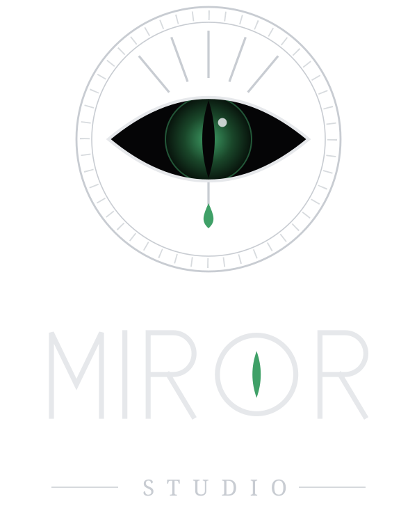
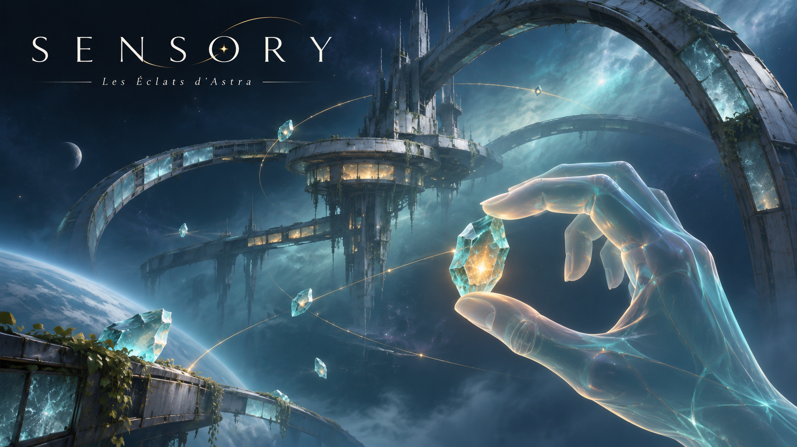

# Sensory — Les Éclats d’Astra

### Une aventure MirorStudio · Vos mains sont la clé

*Illustration d’ambiance de Sensory ; ce visuel n’est pas une capture du jeu.*

Pour protéger les refuges de la **Marée blanche**, Astra a choisi le silence. À bord de l’arche orbitale, des reliques attendent de retrouver leur place. Guidé par **Élye**, explorez les lieux, reliez les indices et rouvrez le passage vers les étoiles.

**Sensory** est un escape game orbital joué avec les mains devant une webcam : pincez pour saisir, déplacez les reliques et utilisez-les ailleurs dans la station. Les mains holographiques font le lien entre vos gestes et le monde du jeu.

[**Télécharger Sensory pour Windows 64 bits**](https://github.com/Toka120/PINCH/releases/download/v3.0.0-preview.6/PINCH-Portable.exe)

Aucune installation nécessaire. Le fichier distribué conserve le nom `PINCH-Portable.exe` pour garder le lien de téléchargement existant ; vous pouvez le renommer **Sensory.exe**.

### Sensory sous Unity : entrer directement dans la station

[**Épisode I et déplacements dans Unity**](https://github.com/Toka120/PINCH/releases/download/v3.0.0-preview.6/PINCH-Portable.exe)

La migration a commencé : sas obligatoire, deux mains articulées, relique à saisir, sac et couronne aimantée. Le suivi natif tourne indépendamment du rendu, avec un repère vidéo constant, des identités persistantes, une pince mesurée en 3D estimée et un diagnostic visible. Il utilise toujours MediaPipe ; les doigts occultés et certaines rotations restent difficiles avec une webcam.

**Après la calibration et l’introduction, vous entrez directement dans la station et pouvez vous déplacer.** Le Seuil de Résonance devient une activité facultative depuis la carte. Vous pouvez y pincer deux prises de lumière et écarter les mains pour tisser une fenêtre sur Astra, ou choisir **Entrer dans la station** à tout moment sans finir le tissage.

Après les trois étapes de calibration, une **cinématique 3D de 26 secondes démarre automatiquement** : réveil de la capsule, découverte de la station et accueil d’Élye avec une voix française et des sous-titres. Elle peut être passée à l’index ou revue depuis la carte ; la narration est incluse et fonctionne hors ligne.

Le parcours principal de l’**épisode I** est désormais jouable dans cinq lieux Unity reliés : jardin, sas, archives, observatoire et porte. Formez un **V avec l’index et le majeur**, les deux autres doigts repliés : vers le haut pour avancer, vers le bas pour reculer, vers les côtés pour tourner. Une brève confirmation précède le mouvement ; une perte de suivi, une pince ou un menu l’arrête. Ouvrez la main avant de reprendre. ZQSD ou les flèches restent disponibles.

L’application est désormais **uniquement la version Unity**, avec le parcours principal, l’inventaire, les énigmes et cinq souvenirs facultatifs. L’ancien exécutable et le bouton qui l’ouvrait ont été retirés. Les contenus supplémentaires qui ne sont pas encore portés ne sont pas présentés comme disponibles. L’introduction garde le logo officiel MirorStudio. [Lire les détails de cette version](https://github.com/Toka120/PINCH/releases/tag/v3.0.0-preview.6).

## Vos gestes font le jeu

- **Pincez le pouce et l’index** pour saisir une relique, puis déplacez votre main pour la transporter.
- **Ouvrez les doigts** pour la relâcher ou la ranger dans le sac orbital.
- **Reprenez une relique du sac** et utilisez-la sur un mécanisme dans un autre lieu.
- **Posez l’index environ 0,75 seconde sur une commande** : un anneau se remplit, puis le bouton s’active. Retirez le doigt avant de recommencer.
- **Balayez avec la main ouverte** pour fermer les souvenirs, les transmissions et les épilogues.

Le bouton **Commandes**, au centre du terrain, ouvre une console à quatre grandes cases. Une mauvaise utilisation ne détruit pas vos reliques ; la progression est sauvegardée sur votre PC.

## Une arche à explorer

Cinq lieux reliés, à découvrir et à revisiter :

- Le **Sas des Échos**, cœur endormi de la station.
- Le **Jardin des Comètes**, où poussent les cristaux d’éther.
- Les **Archives Lunaires**, gardiennes des trois runes.
- L’**Observatoire**, qui se souvient du ciel.
- La **Porte des Astres**, dernier voile avant la liberté.

Élye est une présence née des messages librement confiés à la station. Les traces des sœurs Iria et Mara Venn et du cartographe Naël accompagnent votre exploration.

Le journal conserve les indices ; le sac, les énigmes résolues, la position et l’orientation sont sauvegardés. **Cinq souvenirs facultatifs** enrichissent ce parcours et restent accessibles après la fin normale.

Le pupitre central donne accès à la carte, au journal, au diagnostic des mains et à un guide des déplacements.

## Avant de jouer

Lancez Sensory, découvrez le logo **MirorStudio**, puis effectuez la **calibration obligatoire à chaque session** : vos pinces, votre espace, votre précision. L’introduction démarre automatiquement, puis ouvre directement la station. Après deux secondes d’introduction, **Entrer dans la station**, Entrée ou Échap permettent de la passer.

**Windows 64 bits, webcam et éclairage suffisant.** Aucune connexion Internet nécessaire pour jouer. La souris reste disponible pour les menus, et ZQSD, WASD ou les flèches pour les déplacements. Les reliques se saisissent avec les mains.

La vidéo est traitée sur votre PC, sans enregistrement ni envoi. Aucun microphone n’est demandé. Le suivi d’une caméra unique reste une estimation : sa qualité dépend de la webcam, de l’éclairage et des doigts masqués.

### Si la caméra est déjà utilisée

Sensory essaie un lecteur Windows en **lecture partagée** si la webcam par défaut est occupée. Le sas permet aussi de sélectionner cette source ou une caméra virtuelle installée. Certains pilotes exclusifs empêchent encore le partage ; une autre webcam ou une caméra virtuelle peut alors être nécessaire.

Sur les versions Windows compatibles, les paramètres de caméra peuvent proposer une option multi-application. [Explications Microsoft](https://support.microsoft.com/en-us/windows/hardware/camera/manage-cameras-with-camera-settings-in-windows-11).

L’EXE n’est pas signé numériquement ; Windows peut afficher un avertissement.

## Dernières améliorations

**Préversion 6** — Accès direct à la station après calibration et introduction, guide visible des premiers déplacements, Seuil facultatif et retrait de l’ancienne application embarquée.

---

**Sensory · MirorStudio**  
Suivi : MediaPipe Tasks Vision · Moteur : Unity.  
Ancien nom du projet : PINCH ORBIT. Le dépôt et le nom de l’artefact de distribution sont conservés pour la continuité des liens.
